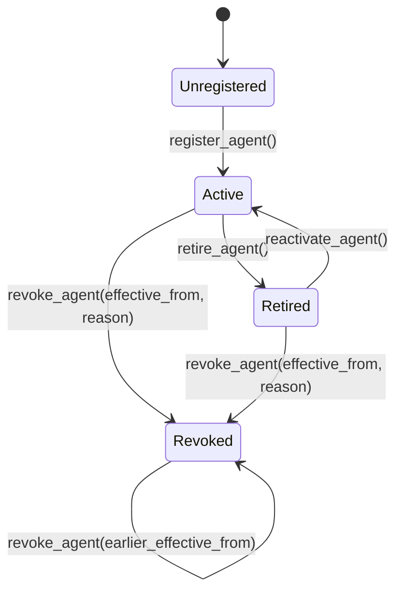

# Frontend architecture

## Self-hosted assets and origins

Every asset is served from this origin. There are no third-party fonts or
illustrations: `next/font/google` downloads and self-hosts Geist/Geist Mono/
Inter at build time, icons come from `components/ui/icon.tsx`, and images live
in `public/images/`. `next.config.ts` sets `images.remotePatterns: []`, so
`next/image` refuses remote sources. `npm run check:origins` scans the build
output after `npm run build` and fails on any origin outside the configured
API, RPC, IPFS, x402 and explorer endpoints; reviewed non-fetch strings live
in `scripts/external-origins.allow.json` with a reason. Wallet kit endpoints
(WalletConnect, Albedo, Trezor) are contacted only after the user opens a
wallet, and are listed there as such.

## Untrusted input

Identifiers are parsed before use with the strict parsers in
`lib/validation/ids.ts` (UUID/slug, u64, 32-byte hash, CID, G-account,
C-contract). API paths are built with `apiPath` in `lib/api/client.ts`, which
encodes each segment and refuses traversal; the request layer also checks the
final URL stays under `API_URL`. Socket payloads are validated by
`lib/validation/events.ts` and invalid events are dropped. `explorerTx`,
`explorerAccount` and `ipfsUrl` return `null` for invalid input, and external
URLs from backend data pass `safeExternalUrl` before being rendered as links.

### Address entry

All user-entered Stellar addresses in `app/` must go through `<AddressInput>` (`components/ui/address-input.tsx`), backed by `lib/stellar/address-policy.ts` and `lib/stellar/address-book.ts`. An ESLint `no-restricted-syntax` rule flags raw `StrKey.isValidEd25519PublicKey` calls in `app/**`.

- **`watch`** (e.g. `/portfolio` watch form): warns on prefix/suffix look-alikes against known counterparties and requires a one-click confirmation. External `?watch=` links do not switch silently; they stage `pendingWatch` in `ViewedAddressProvider` for explicit confirmation.
- **`authority`** (e.g. `/admin/agents`, future admin handovers): enforces expected address kind, blocks look-alikes until the user re-types the last 8 characters, and requires explicit confirmation on first-time addresses with `<AddressText>` showing full 4-character chunks and a deterministic 5×5 identicon.
- **`recipient`** (transfers and treasury operations): same confirmation gates as `authority`, and offers to save confirmed recipients to the per-wallet, per-network local address book.

## Where data comes from

The frontend has two sources that can disagree, and it says which one a value came from (the small `chain` / `backend` tags in the UI).

| Data | Source | Why |
|---|---|---|
| Prices, reserves, market status, positions, USDC balance | **Chain**, via simulated contract calls (`lib/hooks/useStellar.ts`) | The contract is the truth; the backend's copy can lag. |
| Question text, category, reasoning traces (metadata), subscriptions, platform counts | **Backend** (`lib/api/*`, `docs/api.md`) | Not stored on-chain in readable form. |
| Trace content | **IPFS**, then hash-checked against `reasoning_registry.get_trace` | Gateways are not authenticated; content is shown only if its sha256 matches the chain (`lib/stellar/trace.ts`). |
| Treasury risk caps (`max_trade`, `max_market`, `max_daily`), daily usage, available capital | **Chain**, treasury `get_config`, `daily_usage` and `available_capital` (`lib/hooks/useTreasury.ts`) | Read on `/portfolio` without auth. The reset countdown uses ledger close time. The backend's `availableCapitalRaw` is flagged when it differs from the chain for two refetches in a row. Per-market exposure and the paused flag aren't readable yet (see `docs/contract-requests.md`). |
| Per-market trade tape | **Chain** `Trade` events, extended by validated socket events | Contract-spec topic filters select one market. Backward ledger windows with forward cursor pagination find the newest rows; RPC retention limits history. Socket copies are replaced by decoded RPC copies on refetch. |
| Per-market price history | **Chain** market-core `getEvents`, decoded and bucketed client-side (`lib/stellar/price-history.ts`, `lib/charts/*`) | Event retention bounds history; the chart shows coverage and the retention reason explicitly. Decoded points cache in IndexedDB per market (32-entry in-memory fallback when storage is unavailable). |
| Wallet inbox | **IndexedDB**, populated from validated own-wallet events and the transaction tracker | Scoped by address and network passphrase. It contains no agent portfolio data. Resolution/redemption events are polled every 60 seconds while visible; current contract status catches resolutions outside retention. |

A backend market links to the chain through `onChainMarketId` (market-core's `u64` id, a decimal string in JSON). On-chain markets the backend doesn't know are still listed on `/markets`, with on-chain data only.

## Wallet and login

### Provider tree

`app/layout.tsx` nests providers and global banners in this order:

1. `BuildIdentityBanner` (outside providers; reads static `BUILD_IDENTITY`)
2. `PwaRegistrar` (service-worker registration and update-pending context)
3. `WalletProvider` (wallet adapter, network state, signer, query client)
4. `ViewedAddressProvider` (must sit inside `WalletProvider` for `useWalletAddress()` and `useQueryClient()`)
5. `CopyTradeReconciler`, `ErrorReportingInit`, `ConsentBanner`
6. `RealtimeProvider` → `HealthProvider` → `InboxProvider`
7. `Navbar`, followed by a sticky wrapper containing `IntegrityBanner` and `ViewingBanner` (so they stack rather than overlapping), then `NetworkConsistencyBanner`, `RpcDegradedBanner`, `#main-content`, `Footer`, `DebugMount`, `WebVitals`.

### CI jobs

| Job | Purpose |
|---|---|
| `install` | Installs root `node_modules` once and caches by `package-lock.json` hash |
| `frontend` | Runs `check:ci-claims`, bindings/env/SDK/API/docs checks, `typecheck`, `lint`, `test`, `test:scripts`, `build`, origin/secret scans |
| `x402-contract` | Caches x402 service deps, runs `check:x402`, `tsc -p e2e/x402`, and `e2e:x402` inside `unshare --net` (no egress) |
| `secrets-canary` | Verifies `scan-build-secrets.mjs` catches a synthetic canary secret |
| `perf` | Builds production bundle and runs Lighthouse CI |

### User-scoped data

Backend routes using `requireAuth` or `optionalAuth` use `userKeys`, prefixed
with `["scope", walletOrDash, sessionIdOrDash]`. Trace bodies and lists,
allowances, payments, positions, portfolio and admin jobs follow this rule.
Public markets and platform statistics keep `publicKeys` and survive sign-out.
The session id is random per sign-in and stored in `localStorage`; bearer
tokens never appear in query keys.

`UserScopeStore.resetUserScope` runs synchronously on wallet disconnect,
account change, invalid/expired token and sign-in. It cancels and removes only
the previous user scope, aborts its mutation requests, detaches their pending
observers, and discards late results. Chain caches are also removed on account
change, disconnect and token invalidation. Scoped API requests bind to the
expected session before sending and after receiving, so an old response cannot
clear or populate a new session. `TOKEN_EXPIRED`, `INVALID_TOKEN` and
`UNAUTHORIZED` clear the session and notify the provider.

### Session transport

The backend sets the session as an `HttpOnly; Secure` cookie (`od_session`)
plus a readable `od_csrf` cookie. `NEXT_PUBLIC_SESSION_MODE=cookie` (default)
makes `lib/api/client.ts` send `credentials: "include"` and an
`X-CSRF-Token` header on every non-GET request; no JWT is written to
`localStorage`, `sessionStorage` or a JS-readable cookie. Only
`oracledesk_wallet` remains, as a UI hint.

`GET /auth/session` is the source of truth for which wallet the cookie belongs
to; `WalletProvider` asks for it on mount and feeds the answer into the state
machine (`SESSION_SYNCED`). Disconnect and wallet switches call
`POST /auth/logout` before a new sign-in starts (`lib/api/auth.ts` serializes
logout → sign-in, so a late logout cannot clear the new cookie).
`POST /auth/verify` is sent with `X-Session-Mode: cookie`.

### Login proof of work

During challenge issuance bursts (above `AUTH_POW_THRESHOLD_PER_MIN`), the backend gates `POST /auth/challenge` behind a hashcash-style proof of work, responding with `429 POW_REQUIRED` and challenge details `{ bits, salt, retryAfterSecs }` (plus `X-Auth-PoW: bits=<n>; salt=<hex>` and `Retry-After`).

- **Preimage format:** UTF-8 encoded string `oracledesk-auth:${account}:${nonce}:${salt}`.
- **Base account rule:** For Stellar muxed addresses (`M...`), the base Ed25519 `G...` account is extracted before hashing so the preimage matches the backend's `identity.account` verification.
- **Solver & Workers:** Solving executes in a dedicated module Web Worker (`lib/auth/pow.worker.ts`). When `navigator.hardwareConcurrency >= 4`, two workers search disjoint nonce ranges in parallel. The solver uses incremental `Sha256` midstate cloning to avoid recomputing the fixed 64-byte prefix block.
- **Main-thread fallback:** If Web Workers or CSP worker execution are unavailable, solving falls back to `lib/auth/pow-runner.ts` which yields via `scheduler.yield()` or microtask timeouts every 2,000 hashes (< 50ms per slice).
- **Difficulty ceiling:** Controlled by `NEXT_PUBLIC_AUTH_POW_MAX_BITS` (default `24`). If requested bits exceed this ceiling, sign-in refuses with a clean user-facing error rather than exhausting device resources.
- **Retries & Expiry:** At most two solve retries per attempt (including handling `POW_INVALID` via `GET /auth/challenge/pow`). `Retry-After` headers are strictly respected before re-requesting.
- **CSP compliance:** Loaded with `new Worker(new URL(...), { type: "module" })` conforming to CSP `worker-src 'self'`.

One-shot migration: on first load in cookie mode, a legacy
`oracledesk_token` is exchanged with `POST /auth/upgrade` and then deleted
(success or 401). A network failure keeps it for the next load. Cross-site
deployments where third-party cookies are blocked must use
`NEXT_PUBLIC_SESSION_MODE=bearer`; a same-site API subdomain or a Next rewrite
proxy keeps the cookie first-party.

Copy-trade reads traces through `useTrace`; it never retains a trace in an
independent component-state cache. Add new authenticated hooks through the same
key factory and `useScopedMutation` guard.

`lib/stellar/WalletProvider.tsx` wraps `@creit.tech/stellar-wallets-kit` 2.5.0 (pinned: the last release built on `@stellar/stellar-sdk` 16, the same major as the contract bindings). The application and bindings share SDK 16; hardware-wallet internals can carry separate transitive versions.

- The kit is imported dynamically in an effect, because it reads `localStorage` when its module loads.
- A session the kit persisted is restored without prompting and without redirecting. Only a connect completed in the modal redirects to `/markets`.
- After connecting, the wallet signs the backend's SEP-10 style challenge transaction (`signTransaction`, which every Stellar wallet supports; `signMessage` is not universal). The backend returns a JWT. A stored session for a different address is cleared, never reused.
- `useWallet()` exposes `address`, `isWrongNetwork`, a `signer` for the binding clients, `openModal`, `ensureSession` and `disconnect`.

### Runtime network consistency

The provider checks RPC `getNetwork` on startup (two retries for unreachable
servers). A passphrase mismatch shows a blocking banner and blocks the shared
RPC transport, including chain reads outside React Query. Retry can recover
after the operator repairs the endpoint. An unreachable RPC is shown separately
and rechecked before signing; it is never treated as a confirmed mismatch.

Wallet network state is `match`, `mismatch`, or `unknown`. Kit STATE_UPDATED
contains the kit-selected network, so it is deliberately ignored as network
evidence. `getNetwork` is probed before transaction, auth-entry and login signing,
every 15 seconds for reporting wallets while visible, and on returning to the
tab. Unknown wallets require an explicit confirmation in the wallet menu, per
address/module; disconnect/reconnect forgets it. Storage failures are harmless.

Account changes or a transition to a mismatched network invalidate the network
epoch and purge chain caches. Signing and submission are separate steps: late
signatures are discarded, and the lifecycle checks its captured epoch immediately
before submission. Transactions already submitted continue being monitored and
are never reported as failed merely because the wallet network changed.
SEP-10 checks the backend's advertised passphrase against the app configuration
before parsing or signing the challenge.

### Wallet context slices

The provider publishes six memoized slices instead of one context value, so a
component is only re-rendered by the part of the wallet it actually reads.
Each slice is a separate React context with a value that only changes when
its own fields change.

| Hook | Slice | Changes when |
|---|---|---|
| `useWalletAddress()` | identity | the connected account changes |
| `useWalletNetwork()` | network | the wallet reports a network, or it is the wrong one |
| `useWalletSession()` | session | the backend session is created or lost, or an error is set |
| `useWalletSigner()` | signer | the connected account changes (the signer is bound to it) |
| `useWalletActions()` | actions | never — `openModal`, `ensureSession`, `withSession` and `disconnect` keep the same identity for the life of the provider |
| `useWalletMeta()` | meta | the kit reports which wallet module is in use |

`useWallet()` is kept as a compatibility facade: it returns the same
`WalletContextValue` shape as before, composed from the slices. **It
re-renders on any wallet change**, so it should be avoided in components that
render often (the trade ticket, the wallet dropdown, the trade tape). Use the
narrow hook for the field you need.

The actions read the wallet machine's current state when they are called, not
when they were created, so a stale closure cannot sign in with a previous
account. The machine also keeps the *same state object* when an event does not
change anything (a kit event that repeats the current address and network),
so the provider does not re-render at all for kit chatter.

The quick-view modal keeps its amount input, quote and trade in
`components/market/buy-ticket.tsx`, so typing in the amount field re-renders
the ticket and nothing else in the modal. The measurements are in
`docs/perf/wallet-context.md`; `lib/dev/profiler.tsx` logs the same numbers
from the browser during development.

## Contract calls

### Durable copy-trade recording

Copy trades have a local outbox under `oracledesk_copy_outbox:<wallet>`, capped
at 50 entries with terminal records pruned first. It saves the backend intent
before the wallet prompt and the immutable hash immediately after signing,
before submission. It survives reloads; if storage is blocked, the trade still
works with an in-memory outbox and the page asks the user to keep the tab open.

One root reconciler verifies RPC SUCCESS and decodes the exact market-core buy
(contract, trader, market, outcome and collateral amount from the backend
payload) before confirming. Failed/mismatched transactions never confirm.
Retries start at 5 seconds and cap at 10 minutes; entries older than 26 hours
are abandoned because RPC history may have expired. Missing hashes are shown
with account-history links and are never guessed. Auth errors pause until an
explicit fresh sign-in; they never open a repeating wallet prompt.

The copy-trade and portfolio panels expose recording state, Retry and Dismiss.
Dismiss is local only: there is no backend cancellation endpoint, so rejected
or abandoned intents can remain PENDING there. Per-tab in-flight locking avoids
duplicate confirms in one tab; two tabs may PATCH the same immutable hash,
which the backend handles idempotently. A saved hash can never be replaced.

### Contract reads and writes

- `lib/stellar/clients.ts` builds a generated binding `Client` per contract, optionally with the wallet as signer. The USDC Stellar Asset Contract has no Wasm and so no bindings; `token.balance` and `token.transfer` are built with `AssembledTransaction.build`.
- Read-only clients are memoised by contract, RPC URL, passphrase and timeout. Each generated constructor decodes every base64 spec entry, so the first factory call caches the parsed `Spec`; signer-bound clients are then built with the base `contract.Client` from that spec, keyed by the signer object and `publicKey` in a `WeakMap`. All clients share one `rpc.Server` per URL (`rpcServer`), so quote and simulation calls reuse one HTTP client. `__resetClientCaches()` and `__specBuildCount()` exist only for the cache tests and benchmark.
- Reads are simulations (no fee, no signature), except the batched market list described below. Write-adjacent reads deliberately stay on simulation so they cannot observe a ledger entry older than the write they are preparing.
- `node scripts/bench-clients.mjs` measures generated-client construction and quote building against the cached path without network calls.
- Writes (`useBuy`, `useSell`, `useRedeem`, `useUsdcTransfer`) check that a wallet is connected and on the right network, run fresh contract preflight checks, simulate, then `signAndSend`. A per-address queue serializes complete build/sign/send jobs in this tab and coordinates browser tabs with Web Locks (or a local-storage lease fallback); stale-sequence errors receive one fresh-build retry. The buy, sell, redeem, and USDC-transfer paths can decode the final simulated contract invocation and show its arguments and transaction envelope for review before the wallet prompt.
- `useBuy` quotes again immediately before building the transaction and sets `min_shares_out = minOut(quote, slippageBps)`, so slippage is enforced on-chain.

### Creator liquidity claims

Quick-view shows a creator panel only for a matching connected G-address, and
hides it on a network mismatch. `lpView` computes all values in bigint from the
same on-chain market snapshot: the winning reserve for YES/NO, or floor of half
the reserve sum for Void. Open pool value is a labelled spot-price estimate.
Accrued fees belong to the treasury and never increase the creator's payout.

Backend seed metadata is displayed only when its integer seed calculation
reproduces the on-chain reserves and sets minted. After trades, or without
matching metadata, seed figures are omitted. A MarketCreated event would be the
authoritative historical seed source, but RPC event retention limits discovery.
The fixtures record outputs from the pinned contracts Python model using the
Rust creation and Void-claim test inputs.

Claiming re-reads the market through simulation, checks creator, finality and
`lp_claimed` before prompting, then signs/submits through the existing guarded
queue and transaction lifecycle. Success invalidates market, position, USDC and
account balances. A zero payout still marks the pool claimed. Normal creator
seed shares must be redeemed separately; fees are swept separately by the
treasury flow.

### Batched market reads

`useOnChainMarkets` and `fetchOnChainMarket` coalesce calls made in the same tick through `lib/stellar/market-batch.ts`. Each request asks `getLedgerEntries` for at most 200 market keys (spec-driven `DataKey::Market(u64)` encoding from `lib/stellar/ledger-keys.ts`), maps entries back by `LedgerKey` rather than response order, and decodes `Market` with the cached binding spec. The result carries the entry's ledger, persistent-entry TTL (`liveUntilLedgerSeq`) and read method (`ledger-entry` or `simulation`). An entry the RPC omits, or an archived one, falls back to the existing simulation read. Resolved and void markets with no reserves stay readable with `yesBps: 0` instead of failing the whole batch.

`/markets` runs one page-level heartbeat (`useMarketsHeartbeat`) rather than an interval per card. It invalidates the market list on a fixed cadence, and the batcher collapses all cards' reads into as few RPC requests as possible. The admin diagnostics sampler reuses the same reader.

## Admin diagnostics

`/admin` shows live diagnostics instead of demo data: backend and chain market counts, sampled status/probability comparisons, RPC latency, and the indexer's last ledger. The sampler reads the newest ten markets plus a rotating sample from the rest, uses the same batched ledger reader as the market list when possible, limits itself to three in-flight reads and a ten-reads-per-second token bucket, and links each mismatch to the affected market. `/admin/agents` merges registry events, `deployments.testnet.json` and `NEXT_PUBLIC_KNOWN_AGENTS`, reads live `is_registered` for each address, and offers register/unregister review with a typed confirmation. Neither page fabricates a healthy state.

### Market generation jobs

`/admin/create` starts one market-maker run with `POST /markets/generate` and an `Idempotency-Key` per click (the backend requires one; a retried request can't start a second paid run). It sends `{}`: the agent picks the question, category and close time itself. Started job ids are stored per admin address and network in `localStorage` (`oracledesk_admin_jobs:<network>:<address>`, newest first, at most 50; `lib/admin/job-store.ts`) and shared across components and tabs through `useSyncExternalStore` and the `storage` event, so each tab polls each job with one query. `useMarketGenerationStatus` polls `GET /markets/generation-status/:jobId` every 5 s, 15 s once the server's `elapsedMs` passes two minutes, and stops on `COMPLETED`, `FAILED`, `UNKNOWN` (the backend restarted; only its start log survived) or `404 JOB_NOT_FOUND` (pruned an hour after finishing), which maps to `NOT_FOUND`. Auth errors are not retried; polling pauses with "Sign in again to keep tracking". Elapsed time is the server's `elapsedMs` plus only the local time since that answer. The job feed is derived from these states (`lib/admin/job-events.ts`); a `COMPLETED` job with `onChainMarketId: null` is explained as dry-run or failed on-chain creation. "Open market" links to `/markets/quick-view?marketId=…`, never `marketUrl`, which is an API path. The "runs in the last hour" count covers this browser only; the backend's limit is 5 per hour per IP, and a 429 shows its `Retry-After`.

### Confirmed wallet updates and reconciliation

Position and USDC balance caches hold `{ value, ledger, provisional?, awaitingRpc? }`; existing hooks select `value`, while `usePositionState` and `useUsdcBalanceState` expose the metadata. Simulations supply the read ledger. A confirmed buy/sell/redeem applies only contract-returned bigint amounts, using the confirmed transaction ledger, and immediately updates an existing cache. Cached values already read at or above that ledger are left alone. Missing caches and unknown transaction ledgers use invalidation instead.

Reads are cancelled before signing and again before the confirmed delta is applied. No delta is applied while awaiting a signature, so rejection and simulation failure leave values unchanged. Consecutive confirmations compose against the latest cache. Negative deltas that exceed cached holdings or balance trigger invalidation. No quote cache is invalidated by this flow.

Reconciliation refetches after 1, 3 and 8 seconds. Reads below the cached ledger cannot overwrite it. At or above that ledger, matching reads remove the provisional marker; different reads replace the value and log `[optimistic] mismatch`. After three lagging reads, the value remains labelled **awaiting RPC**, with its transaction link, until an authoritative read arrives. Query removal on disconnect disposes reconciliation timers. Fee previews are rebuilt with the current wallet before transaction review and signing.

### Reconciliation console

`/admin/reconciliation` is the read-only front end for the backend's periodic market reconciler (`OracleDesk-Backend/src/services/market-reconciler.service.ts`). It is gated on the `reconciliation.run` RBAC permission and never repairs anything itself. The backend owns all writes and the `market-reconciler` advisory lock; the browser only lists runs, starts one with `POST /admin/reconciliation/run`, and reads `GET /admin/reconciliation/runs/:id`.

Runs and findings are polled every 5 s while unfinished, backing off to 30 s and stopping 30 minutes after the oldest unfinished run started. A run that could not take the advisory lock is recorded with a `finishedAt` and the error `another instance is reconciling; run skipped`; the UI labels it **Skipped (lock held)** rather than a failure. Findings are paged 200 at a time and rendered through a windowed virtual table; "Load all" stops at 5,000 findings so a large run cannot lock the tab.

`lib/admin/drift.ts` mirrors the backend's `classifyDrift` vocabulary: `MISSED_RESOLUTION`, `MISSED_VOID`, `CLOSED_BUT_ACTIVE`, `PRICE_STALE`, `CLOSE_TIME_MISMATCH`, `HASH_MISMATCH`, `NOT_FOUND_ON_CHAIN` and `STATUS_REGRESSION`, with actions `REPAIRED`, `REPORTED`, `DEFERRED` and `SKIPPED_NEWER`. It uses the same 60 s close grace window and treats a row `RESOLVING` as non-final. The backend compares prices as floating-point probabilities with a 0.005 tolerance; this classifier compares integer basis points with `|priceYesBps(chain) − round(prob × 10_000)| > 50`. The two agree for the shipped reserve ranges, but the boundary is deliberately tested in `lib/admin/__tests__/drift.test.ts`. Integrity classes (`HASH_MISMATCH`, `STATUS_REGRESSION`, `NOT_FOUND_ON_CHAIN`) are never repaired by the backend; a close-time mismatch next to a hash mismatch is reported rather than repaired as a likely mislinked row. Resolution-class findings are deferred while the indexer is behind the observation ledger.

`lib/admin/recheck.ts` performs an independent browser-side verification: it groups findings by `onChainMarketId`, reads chain state through the shared `MarketBatcher` (at most 200 ids per call), reads backend rows with a three-way concurrency limiter, and classifies each row again against ledger time from `ledgerClock`. `MarketNotFound` confirms `NOT_FOUND_ON_CHAIN`; an archived entry is `unverifiable` with `archived; restore needed`. Results are cached under `["stellar", "recheck", onChainMarketId, ledgerBucket]` and can be refreshed per finding or for the whole page. A resolved re-check is neutral/good; price re-checks are hidden behind an explicit toggle. API guards keep unknown drift classes and actions visible as `unknown class` / `unknown action` and warn in development instead of dropping rows from a newer backend.

`/admin` diagnostics now uses the same class names for status, price and missing-chain samples; a missing backend row remains frontend-only because there is no backend finding to classify. CSV and JSON exports preserve exact strings (ids and bigints are stringified, never parsed as floats) and redact actor-like fields only; market ids and hashes stay public. The console does not subscribe to the admins socket and does not change backend pagination.

## Write path and transaction lifecycle

Every state-changing write (`useBuy`, `useSell`, `useRedeem`, `useUsdcTransfer`) follows an explicit, observable lifecycle governed by `TxLifecycle` in `lib/stellar/tx-lifecycle.ts`:

1. **Fee Preview & Simulation**: Before signing, `usePrepareBuy` and `usePrepareUsdcTransfer` simulate the transaction. `lib/stellar/fees.ts` calculates `feeBreakdown` (inclusion fee, resource fee, and Soroban resource footprint) and computes `spendableXlm` from the account ledger entry following CAP-33 rules (`minBalance = (2 + numSubEntries + numSponsoring - numSponsored) * baseReserve`). If spendable XLM is below the estimated total fee, the UI disables submission with an exact deficit warning.
2. **Observable Lifecycle Phases**: `useTxRunner` drives the transaction through typed phases:
   - `building` → `simulating` → `awaiting-signature` → `submitting` (hash available) → `pending` (polling with backoff) → `confirmed` | `failed` | `expired`.
   - Expiration is determined from `latestLedgerCloseTime` reported by Stellar RPC, not the browser clock.
   - Statuses and errors (`PENDING`, `DUPLICATE`, `TRY_AGAIN_LATER`, `ERROR`, `txBadSeq`, `op_low_reserve`, etc.) are mapped cleanly to `TxDescribedError`.
3. **Session Transaction Tracker (`lib/stellar/tx-tracker.tsx`)**:
   - `TransactionTrackerProvider` mounted in `WalletProvider` captures every submitted transaction as soon as the hash is known.
   - Transactions are serialized to `sessionStorage` (`oracledesk_pending_txs`) with BigInt amounts as strings, resuming polling on page reload.
   - Polling across multiple browser tabs is coordinated with `BroadcastChannel("oracledesk-tx")` to ensure only one tab polls the RPC server.
   - Upon confirmation, `tradeInvalidationKeys` performs React Query cache invalidations across market, positions, and balance queries even if the initiating component unmounted.
   - The `<TxToastContainer />` component (`components/ui/tx-toast.tsx`) renders accessible toasts announcing state transitions and supports resuming premium daily pass activation follow-ups.

## Reading contract results

All contract results must be read through `read(tx, contract)` for simulations and `submit(tx, contract)` for transactions (`lib/stellar/typed-call.ts`).

- **Type inference**: `read` and `submit` automatically infer their return types from the binding method's return type using the `Unwrapped<TxValue<Tx>>` type utility. Contract `Result<T>` values are unwrapped to `T`, while plain return values (such as `Position` or `u64`) are passed through unchanged.
- **No manual type arguments or hand-written shapes**: Never pass explicit generic type parameters to `read` or `submit` (e.g. `read<MyType>(...)`), and never write out return interfaces by hand. An ESLint `no-restricted-syntax` rule enforces that call sites cannot pass type arguments to `read`, `submit`, or `simulated`.
- **Runtime Result detection**: Contract `Result` values are identified using SDK `instanceof Ok` and `instanceof Err` checks from `@stellar/stellar-sdk/contract`. Plain objects that happen to have an `isOk` property are never mistaken for Results.
- **Trace hash conversion**: The byte buffer (`Buffer` or `Uint8Array`) returned from `get_trace` must be converted to hex using `bytesToHex(trace.trace_hash)` rather than ad-hoc `Array.from` routines.
- **Pinning types**: Whenever the application starts using a new contract binding method, add corresponding type assertions to `lib/stellar/__tests__/typed-call.test-d.ts` (using `Value<Client, Method>` and argument parameter shapes) with `.not.toBeAny()` guards. This ensures that any upstream contract signature changes fail the test suite immediately.

## Amounts

USDC has 7 decimals. Anything that can reach a transaction is a `bigint` in base units (`lib/stellar/units.ts`). Parsing rejects floats in exponent form and more than 7 decimals. Display floats exist only at the edge of the UI.

## Market price chart

`/market` shows a real step-line YES-price chart for the market in `?onChainId=` (Suspense-wrapped `useSearchParams`). `loadPriceHistory` (`lib/stellar/price-history.ts`) pages `getEvents` newest-first (1,000 per page, 20 pages max), clamps the window to RPC retention, decodes `Trade` events into `{ price, reserves, timestamp }` points with the pinned FPMM math, and caches serialized points in IndexedDB per market. `usePriceHistory` refetches every 15 seconds while the tab is visible.

Points bucket on a worker (`lib/charts/bucket.worker.ts`) into fixed widths per period (1H→5m, 1D→30m, 1W→6h); the fallback path buckets on the main thread when workers are unavailable. The chart renders only after a mount frame so `ResponsiveContainer` always has a measured width (this is what removed the `width(-1)` warning class). Chart colors come from CSS variables (`--chart-yes`, `--chart-no`, …), never hex literals in components.

## Errors

`lib/stellar/errors.ts` turns SDK, wallet and contract failures into plain sentences. It first recognises SDK error classes by `name` (`UserRejectedError`, `NoSignerError`, `ExpiredStateError`, `RestoreFailureError`, `ExternalServiceError`), then decodes submission result codes, then attributes contract errors from diagnostic events: the last event whose topic is `error` and whose `ScError` is `sceContract` names the contract id that failed. A SAC failure inside `market_core.buy` is therefore attributed to `CONTRACTS.usdc` and never run through market-core's error table, even when the numbers overlap. Text regexes remain as a fallback, covered by `lib/stellar/__tests__/fixtures/errors/` and fast-check fuzz tests.

## Observability

Three opt-in layers, all off unless configured (see `.env.example` and `docs/privacy.md`):

- **Error reporting** (`NEXT_PUBLIC_ERROR_REPORTING_DSN`, issue #123): `lib/observability/report.ts` captures errors with reference ids, consent (default denied, DNT/GPC honoured), rate limiting and dedupe; `lib/observability/redact.ts` strips JWTs, seeds, XDR and addresses (salted HMAC) and drops any event where a token pattern survives the second pass. `app/error.tsx` / `app/global-error.tsx` render the recovery UI with the reference.
- **Trace context** (issue #124): `lib/observability/tracing.ts` implements W3C `traceparent`. Every `lib/api/client.ts` request sends `traceparent` + `X-Request-Id`; multi-step flows run inside `withOperation` ("sign-in", "premium-unlock", "copy-trade", "generate-market") so all of a flow's requests share one trace id, and user-visible failures append `Reference: <first 8 hex>` (`formatErrorWithReference`). The sign-in verify request also carries `X-Challenge-Hash` (sha256 of the challenge XDR) so the backend can bind the signature to the issued challenge. `ApiError.requestId` keeps the id (backend's `x-request-id` when echoed) for reports.
- **RPC spans** (same module, issue #124): with `NEXT_PUBLIC_OTEL_EXPORTER_URL` set, `initTracing()` patches `fetch` once to time Soroban RPC calls (method, duration, HTTP status) and exports batches over OTLP/HTTP JSON at `NEXT_PUBLIC_OTEL_SAMPLE_RATE` — dependency-free, no OpenTelemetry packages in the bundle. Span attributes are filtered for sensitive keys/values before buffering. `traceparent` is never sent to the RPC provider unless `NEXT_PUBLIC_OTEL_PROPAGATE_TO_RPC=1`. Backend-side propagation of these headers is a backend concern (out of scope for this repo).
- **Funnel analytics** (issue #125): `lib/observability/analytics.ts` exposes a typed `track(event, props)` over the versioned catalog in `analytics-events.ts` (schema pinned by `analytics-schema.test.ts`). Nothing is sent unless `NEXT_PUBLIC_ANALYTICS_PROVIDER` is set **and** the user consents via `components/consent-banner.tsx` (DNT/GPC always deny, events are dropped rather than queued before consent), and a runtime guard drops any event whose properties look like an address, token or exact amount. Providers (`posthog` / `plausible` / `http`) live in `lib/observability/providers/` behind literal dynamic imports so unconfigured builds tree-shake them out. Funnel points: `WalletProvider` (modal/connect/sign-in/network), `useQuoteBuy` + the buy/sell/redeem mutations (submitted → wallet-prompted → completed), premium payment, and one `copy_trade_completed` per copy trade in `useCopyTrade`.

## Generated code

`lib/stellar/generated/` is copied from the pinned `contracts` submodule by `scripts/sync-bindings.mjs`, with a do-not-edit header and `// @ts-nocheck`. CI fails if it's stale. `CATEGORY_TAGS` in `clients.ts` has a compile-time exhaustiveness check against the binding's `Category` type, so a contract enum change breaks the build rather than the UI.

## Contract identities

Every contract id the app can talk to is overridable with a `NEXT_PUBLIC_*` variable, so a forked or tampered build could silently route trades or payments elsewhere. Four pieces guard against that:

- **Manifest.** Besides the raw `deployments.testnet.json`, the sync script generates `lib/stellar/generated/contract-manifest.ts`: network, contracts commit, a sha256 of the deployments file, and the canonical contract/account ids. `npm run check:bindings` fails when it is stale.
- **Resolution.** `lib/stellar/config.ts` exports `IDENTITIES` (label, role, address, `source: "manifest" | "env"`, `matchesManifest` per key, including `paymentsRecipient`) and `BUILD_IDENTITY` (`{ canonical, overridden, manifestCommit }`). A build whose passphrase has no manifest (anything not testnet) is never canonical.
- **Display.** `ContractIdentity` / `SigningIdentities` (`components/tx-review.tsx`) show the label, a role sentence, the full address in 4-character groups, a three-word fingerprint (`lib/stellar/fingerprint.ts`, first 33 bits of sha256(decoded StrKey payload) → three BIP-39 words, a UX aid against vanity addresses — see SECURITY.md), a source badge, and a Stellar Expert link. The premium payment dialog shows `paymentsRecipient` + `usdc` (with an "I checked these addresses" gate when overridden and a note when the recipient is the treasury); quick-view and copy-trade show `marketCore` + `usdc` before signing.
- **Banner and build check.** `components/layout/BuildIdentityBanner.tsx` renders a persistent, non-dismissable banner on every page when `!BUILD_IDENTITY.canonical`, listing the overridden identities and every address. `next.config.ts` prints the same at build time, and `ORACLEDESK_REQUIRE_CANONICAL=1` (build-only env) fails the build instead.

## Rendering

All routes prerender as static pages. Pages that read query parameters (`/markets/quick-view`, `/copy-trade`, `/reasoning/verify`) keep `useSearchParams` inside a `<Suspense>` boundary; without it the production build fails.

### Server and client boundaries

Pages under `app/` should default to server components. Only the smallest interactive subtree should opt into `"use client"`; static marketing copy, pricing tables, feature summaries and layout-only content stay in the server-rendered shell so they do not inflate the client bundle or hydrate unnecessarily.

- Keep page entrypoints in `app/.../page.tsx` as server components that render a lightweight client island.
- Co-locate interactive islands under `app/_components/` or `app/<route>/page-client.tsx` with a single `"use client"` directive at the top.
- Pass only serializable props across the server/client boundary (strings, numbers, arrays, plain objects, URL strings, not functions or `bigint`).
- Wallet, React Query, socket streams, framer-motion and browser-only APIs stay client-only and are never imported into server pages.
- Server pages must not import `lib/contexts/*`, `lib/hooks/*`, `WalletProvider`, or client-only config objects. They are static and should remain free of browser-only code.
- Use `export const dynamic = "error"` on server-shell routes that are meant to stay static. This fails fast if a future change accidentally makes a route dynamic.

### Realtime lists and storage bounds

`RealtimeProvider` owns one socket and one mixed-event scheduler. Valid payloads enter a 500-event bounded batch; subscribers receive at most one batch per animation frame. Hidden tabs accumulate a bounded backlog without updating realtime DOM, then receive one catch-up batch with overflow counts. Feed rings retain six home rows and eight market rows with event IDs as keys. A rolling second above ten events suppresses row animations and displays a summary; reduced motion also disables the ticker and realtime row animations.

The market tape retains at most 2,000 trades per market and 32 cached markets. A fixed eight-row viewport with overscan renders at most 24 data rows plus spacer rows. USDC, shares and fees remain bigint base units; post-trade price uses the pinned FPMM calculation. Each row links to its trader and transaction. Event retention is shown explicitly, including empty histories.

The home hero shows the most liquid ACTIVE market from the markets feed (`pickFeaturedMarket`, deterministic — same list, same market); the ticker formats the same feed through `tickerItems`. No home-page number is invented: no random probability walk, no placeholder volume, no fabricated insight quote.

`/reasoning` renders `useInfiniteTraces` pages merged by `mergeTracePages` (id-deduplicated); an IntersectionObserver sentinel loads the next page with an explicit button fallback. `listTraces` narrows response `meta` through `isPaginationMeta`, because older deployments omit pagination meta — the feed simply stops after page one there. Trace cards render only the preview sources the backend actually sent; locked traces say so instead of showing fallback synthesis or invented source-weighting numbers.

`InboxProvider` remounts for each address/network pair, closes its previous database handle, and renders nothing from the previous owner. `oracledesk-inbox` stores deterministic item IDs, read state and the last processed ledger. Duplicate deliveries preserve read state and creation time. The inbox retains 500 items, pruning oldest read items first, and displays the newest 200. Storage failures fall back to memory with a visible notice. Reading a page does not mark anything read; the user explicitly marks one item or all items. Held-market discovery uses the owner's saved fills and already-read position queries; it does not scan all ledger keys or use the treasury agent's portfolio.

## RPC endpoints

`RPC_URLS` = `NEXT_PUBLIC_STELLAR_RPC_URL` (primary) + `NEXT_PUBLIC_STELLAR_RPC_URLS`. `lib/stellar/rpc-pool.ts` verifies each endpoint with `getNetwork` (wrong passphrase → never used), probes `getLatestLedger` every 15 s while the tab is visible, and keeps the last 50 samples per endpoint (p50/p95, error rate, 429s with Retry-After back-off, ledger lag). Selection is sticky: it switches only when another endpoint scores ≥30% better on two consecutive probes, or the current one is down/degraded. Write hooks run inside `withPinnedRpc`, so quote, simulate, submit and polling use one endpoint; a failed submission is never resent elsewhere. Reads carry the ledger they were simulated at (quick-view shows "as of ledger N") and an older-ledger result never replaces newer cached data. Single-endpoint setups behave as before.

### RPC scheduler (`lib/stellar/rpc-scheduler.ts`)

Every `rpcServer()` method except `getNetwork` passes through `RpcScheduler` in the browser (pass-through on the server and in node tests):

- **Buckets**: per-`(endpoint, methodClass)` token buckets (`simulate`, `send`, `poll`, `entries`, `events`, `meta`) using AIMD (`onRateLimited` halves rate down to 0.2/s and honours `Retry-After`; `onSuccess` adds 0.1/s up to the class ceiling).
- **Priority classes**: `submit` (writes under `withPinnedRpc`), `interactive` (quotes and ticket reads), `normal` (default React Query refetches), `background` (events, price history, equity, position scans, probes).
- **25% reserve rule**: `background` calls can only take a token when `tokens > ceil(burst * 0.25)`, reserving headroom for `submit` and `interactive` work. `submit` `getTransaction` polls retain a 1-per-2 s floor even while paused.
- **Fairness & tagging**: Within a priority, per-`tag` FIFO sub-queues are served round-robin. Callers tag background/interactive work synchronously with `withRpcPriority({ priority, tag }, () => ...)`. Queued calls are cancellable via `AbortSignal` and rejected if `rpcNetworkEpoch()` changes while queued.

## Trace verification

The on-chain `trace_hash` decides whether content is shown. Everything else is evidence about why a check failed.

- **Gateway pool.** `NEXT_PUBLIC_IPFS_GATEWAY_URL` is a comma-separated list (at most 5 https gateways; `http://localhost` is allowed for local testing). `lib/stellar/trace-core.ts` races them: gateway *i* starts after *i* × 750 ms, or as soon as an earlier attempt fails. Each attempt has an 8 s timeout. The first attempt whose bytes match the on-chain hash wins, and the others are aborted. A mismatch doesn't end the race, because another gateway may serve the correct bytes.
- **Outcomes.** `verified` means some gateway served bytes whose sha256 equals the chain. `mismatch` means at least one gateway returned bytes and none matched; content is never returned. `unavailable` means no gateway returned usable bytes, or the user cancelled. Every result carries per-gateway `attempts` (outcome, HTTP status, time, bytes), shown on `/reasoning/verify`.
- **Size cap.** `NEXT_PUBLIC_IPFS_MAX_TRACE_BYTES` (default 1 MiB) is enforced while the body streams, so an oversized response is abandoned without being buffered.
- **CID check.** `lib/stellar/cid.ts` checks CIDv1 raw-codec sha2-256 CIDs against the bytes. It reports `match`, `mismatch`, `unsupported` (for example dag-pb, used for multi-block files) or `invalid`. The check is informational and never overrides the on-chain hash. A CID mismatch with a verified hash means the publish is inconsistent. A CID mismatch with a hash mismatch means the gateway served the wrong object.
- **Worker.** `lib/stellar/trace.worker.ts` runs the race, the incremental SHA-256 (`lib/stellar/sha256.ts`) and the JSON decode off the main thread, and posts progress. Only verified bytes are transferred back, as a transferable `ArrayBuffer`. Mismatches carry no bytes. `verifyTraceInWorker` falls back to the main thread when workers are unavailable, and does so for the rest of the session if the worker fails at runtime.
- **CSP.** The worker is a same-origin module (`new Worker(new URL("./trace.worker.ts", import.meta.url), { type: "module" })`). A strict CSP needs `worker-src 'self'` and must not allow `blob:`. Gateway subdomain redirects (for example `dweb.link`) need `connect-src` entries too.

## x402 per-trace unlocks

`lib/x402/client.ts` talks to the contracts repo's trace service (`GET {NEXT_PUBLIC_X402_URL}/traces/:onChainTraceId`) with the same `@x402/*` release the service pins (2.26.0, exact; `node scripts/check-x402-versions.mjs`). Protocol v2 over HTTP: the 402 carries `PAYMENT-REQUIRED` (base64 JSON `PaymentRequired`), the paid retry sends `PAYMENT-SIGNATURE` (base64 JSON `PaymentPayload`), and a settled 200 carries `PAYMENT-RESPONSE` (base64 JSON `SettleResponse`). The Stellar `exact` payment is a Soroban authorization entry for one SEP-41 `transfer(payer, payTo, amount)`, signed by the wallet with `signAuthEntry` (SEP-43); the facilitator builds, sponsors and submits the transaction. Every request sends `Accept: application/json`, because the middleware answers browsers that accept `text/html` with an HTML paywall.

Facts of the pinned client worth knowing:

- The wallet must support Soroban auth-entry signing (Freighter does). The adapter exposes the kit's `signAuthEntry`; signing refuses with a plain message when the wallet can't.
- A bare price (the service's `TRACE_PRICE_USDC`, "0.01") is charged in `@x402/stellar`'s default asset: Circle's testnet USDC SAC `CBIELTK6…DAMA`, not the app's self-issued USDC. Amounts are always read from the 402.
- Building the payment simulates the transfer on the app's Soroban RPC; the scheme passes no `allowHttp`, so that RPC must be https. It also asks Horizon (testnet: `horizon-testnet.stellar.org`) for recent ledger times and falls back to 5 s per ledger. The signature expires at `latest ledger + ceil(maxTimeoutSeconds / ledger seconds)`; `maxTimeoutSeconds` defaults to 300.

### Payment journal and recovery (`lib/x402/recovery.ts`)

Every signed payment is written to IndexedDB (`oracledesk-x402`, store `payments`, indexed by `[wallet, network, onChainTraceId]`) with `durability: "strict"`, and the write must commit before the paid request is sent. If IndexedDB is unavailable, the app refuses to sign. `unlockTrace` checks the journal first:

- an entry in `signed`, `sent` or `failed-retryable` is **redelivered with the same header**, never re-signed, until its expiration ledger (compared with RPC `getLatestLedger`, not the clock);
- network errors and 5xx keep the header and retry after 1 s, 3 s and 10 s;
- a 402 to a paid request, or an entry past its expiration ledger, triggers a settlement check before anything else happens. Settled payments become `settled-undelivered` and are never paid again; the user gets "Retry delivery" and "Copy payment evidence". Unsettled ones only become `expired`, and safe to pay again, once the expiration ledger has passed;
- a 200 whose `traceHash` differs from reasoning-registry's is a delivery failure (`settled-undelivered`, `hash-mismatch`). Otherwise the entry becomes `delivered`, and content is shown only after the IPFS bytes verify against the on-chain hash (`fetchVerifiedTrace`).

The settlement check reads SEP-41 `transfer` events from the wallet to `payTo` on the requirement's asset, in the ledgers where the signature was valid. An event of the right amount counts only if its transaction carries this payment's auth entry (same payer and nonce), so same-priced payments in one batch are never confused. If events are missing for the window (RPC retention), the result is `unknown` and the payment stays retryable. Tabs coordinate through a Web Lock per wallet, network and trace, and a `BroadcastChannel("oracledesk-x402")` that refreshes other tabs' views. The payment header is a bearer credential until it settles or expires. It is never logged, never put into error text, and never part of the support evidence.

**What the pinned `@x402/express` 2.26 does** (read from its source and pinned by `e2e/x402`):

- (a) *Same header replayed after settlement*: there is no delivery cache. Every paid request is verified with the facilitator again, and an auth entry whose nonce was consumed fails verification, so the replay gets a 402, not content. It can't be charged twice either. A settled-but-undelivered payment can't be redelivered against this service (contract request 7).
- (b) *Handler error after payment*: the Stellar `exact` scheme's default flow is `authorization`, which runs verify before the handler and settle after it, and only when the handler answered below 400. The handler's output is buffered meanwhile. A 502 (gateway down, tampered bytes) or 404 (unknown trace) cancels the payment and nothing is settled, so the same header can be resent until it expires. The middleware also prices the route before the handler looks the trace up, so an unknown id still answers 402 first.
- (c) *Client disconnect mid-response*: settlement runs after the handler regardless of the client. A disconnect after `/settle` leaves the payment settled and the response lost; the journal recovers this as `settled-undelivered` through the settlement check.

### Unlock cart (`lib/x402/cart.ts`)

`/reasoning` can collect locked traces (deduplicated by on-chain id; traces not on-chain are rejected). Each is quoted from its live 402, three at a time. The backend's `unlockPriceRaw` is only a hint and is never shown as the charged amount. Checkout pays one item at a time through `unlockTrace`, so each payment has its journal entry and its own wallet prompt. Before every signature the item's 402 is read again:

- a different `payTo`, asset or network is refused;
- a higher price pauses the run until the user accepts it for this item, accepts it for all remaining items, or skips;
- a lower price proceeds, and the receipt records both amounts.

The spending policy runs after that. Without one, a conservative fallback keeps each payment within the run's confirmed total plus any increases the user accepted. A policy denial of `over-daily` or `over-per-trace` skips the rest of the run. Cancelling, or a wallet change, stops before the next item. The receipt (downloadable JSON, bigint amounts as strings) lists each item's status, quoted and paid amounts, settlement hash and verification result, and flags payments that went through without a verified unlock. When the total reaches the daily-pass price, the drawer recommends `/premium`. Everything x402 is hidden when `NEXT_PUBLIC_X402_URL` is empty.

## PWA and service worker

`public/sw.js` (hand-written) is registered as `/sw.js?v=<BUILD_ID>` in production on secure origins only; `next dev` unregisters build workers.

Cached (namespace `shell-<BUILD_ID>`): prerendered route HTML (network-first, 4 s timeout, then cached HTML, then `/offline`) and `/_next/static/**`, `/icons/**`, `/favicon.ico` (cache-first). The list comes from `/_next/static/sw/precache-<BUILD_ID>.json`, written by `scripts/build-sw-manifest.mjs` after `next build` from `.next/BUILD_ID`, `.next/prerender-manifest.json` and every file under `.next/static/` (including lazily loaded wallet-kit chunks).

Never cached or intercepted: any other origin (backend, Soroban RPC, socket.io, IPFS, x402, wallets), requests with `Authorization` or `Range`, non-GET, `/api/`, `/socket.io`.

Update rule: the worker never calls `skipWaiting()` itself. When a new one is waiting, a non-dismissable banner asks the user to reload, and `useWriteGuard` refuses to sign ("Reload to update OracleDesk before signing.") until they do.

## Ledger Heartbeat & Event-Driven Invalidation

Instead of independent intervals across components, `LedgerClock` (`lib/stellar/ledger-clock.ts`) runs a singleton heartbeat querying `getLatestLedger` roughly every 5 seconds while visible.

- **Visibility-Aware**: Polling immediately halts when the tab is hidden and resumes when visible.
- **Exponential Backoff**: Success resets the interval to 5s; RPC failures back off through 10s, 20s, up to 60s with jitter.
- **Event-Driven Invalidation**: Mounted in `WalletProvider` via `LedgerInvalidator` (`lib/stellar/ledger-invalidation.ts`). On new ledgers, `getEvents` queries `marketCore` and `usdc` to invalidate queries matching affected market IDs and user balances. Gaps > 120 ledgers perform a broad invalidation.
- **Query Cache Policies**: On-chain queries have `staleTime: Infinity` with a 5-minute fallback poll; backend queries set `refetchIntervalInBackground: false`.

## Contract integrity check (`lib/stellar/contract-check.ts`, `lib/stellar/integrity-monitor.ts`)

The frontend verifies that the deployed contracts match the bundled TypeScript bindings both at startup and dynamically on ledger ticks:

1. **Instance Check**: Queries persistent contract instance keys for all configured contracts (`marketCore`, `treasury`, `resolver`, `reasoningRegistry`, and `usdc`) in a single batched `getLedgerEntries` call.
2. **Wasm Spec Fingerprint**: For Wasm contracts, extracts the executable's `wasmHash`, fetches the contract code entry if not cached, parses the embedded `contractspecv0` section, normalizes spec entries (stripping doc fields and sorting by kind and name), and computes a SHA-256 fingerprint. The fingerprint is cached in `sessionStorage` per content-addressed `wasmHash`.
3. **Stellar Asset Contract (SAC) Verification**: For USDC, verifies that the instance executable is `contractExecutableStellarAsset`, checks that the contract ID matches `new Asset(code, issuer).contractId(NETWORK_PASSPHRASE)` for `NEXT_PUBLIC_USDC_ASSET`, and simulates `name()`.
4. **Live Integrity Monitor (`lib/stellar/integrity-monitor.ts`)**: Runs on ledger clock ticks. Monitors contract executables and detects upgrades in real time. On executable change or upgrade events, it immediately invalidates the signing epoch via `invalidateSigningEpoch()`, sets status to `rechecking`, purges caches, and verifies the new spec against the bundled definitions.
5. **Pre-Sign Freshness & Write-Path Gating (`lib/stellar/write-guard.ts`, `lib/stellar/tx-lifecycle.ts`)**:
   - `assertCanWrite()` blocks writes when `monitorStatus` is `initial`, `rechecking`, or `failed`, or when the targeted contract status is not `ok`.
   - Right before requesting wallet signature (`awaiting-signature`), `ensureFresh()` guarantees that ledger-check age is < 15 seconds, forcing an immediate probe if stale.
   - `IntegrityBanner.tsx` displays live state: `rechecking` (yellow), `failed` (red, with reload/details), or brief `ok` notice on upgrade without blocking normal operations.

### Contract capabilities (`lib/stellar/capabilities.ts`, `lib/stellar/capability-registry.ts`)

Instead of treating any spec difference as a total mismatch, `resolveCapabilities` compares the on-chain `contractspecv0` structurally (function inputs/outputs and all reachable UDTs: structs, unions, ordered enums, and superset-compatible error enums; doc strings and entry order are ignored):

- `match`: fingerprint equals the bundled spec.
- `compatible`: core capabilities pass while some optional capabilities (`marketCore.buyV2`, `marketCore.splitMerge`, `registry.chainedTraces`, `treasury.vault`, etc.) are missing or incompatible. `IntegrityBanner` shows a quiet expandable info strip and core trading stays enabled.
- `mismatch`: any `core` capability fails.

`useContractCapabilities()` and `getCapabilitySnapshot()` share the React Query cache and `sessionStorage` (`oracledesk_wasm_caps_v1_<wasmHash>_<BUILD_ID>`). `<RequiresCapability cap="..." fallback={...}>` gates optional UI, and `assertCanWrite` enforces `requires?: Capability[]`. Operators can inspect any deployed contract with `node scripts/capabilities-report.mjs --contract <C...> --rpc <url>`.

## Viewed address vs signer (Watch-only mode)

To allow inspecting any Stellar address's positions, balances, and history without connecting a wallet or risking accidental transactions from a signer wallet:

1. **Branded Types (`lib/stellar/identity.ts`)**:
   - `ViewedAddress`: A validated Stellar G-address (`G[A-Z2-7]{55}`) that is being inspected in the UI.
   - `SignerAddress`: A connected wallet's address that can sign transactions.
   - Distinct branded types ensure write paths cannot mistakenly pass a watched address to a signer client.
2. **State & URL Synchronization (`lib/hooks/useViewedAddress.tsx`)**:
   - Tracks `viewed`, `source` (`"url"` | `"session"` | `"signer"`), and `isWatching`.
   - Priority order: URL query param `?watch=<G...>` takes highest precedence, followed by active `sessionStorage.getItem("oracledesk_watch")`, falling back to the connected wallet's `address`.
   - Never stored in `localStorage` or `oracledesk_wallet`, preventing session mixups with the backend.
   - Navigating or clicking "Clear watch" purges the watch session and invalidates user-scoped query caches.
3. **Batched Position Reads (`lib/stellar/positions.ts`)**:
   - `fetchPositionsFor(holder: ViewedAddress, marketIds: bigint[])` encodes `DataKey::Position(holder)` keys and batches up to 200 keys per chunk via `getLedgerEntries`.
   - Missing or unbatched positions fallback to simulating `get_position(holder)`. Zero-balance positions are filtered out.
4. **Write-Path Protection (`lib/stellar/write-guard.ts`)**:
   - `assertCanWrite()` is evaluated in `useWriteGuard()`.
   - If `isWatching` is true and `watchedAddress !== signer.publicKey`, it throws `UserFacingError({ kind: "watch-only", title: "Watch-only mode", message: "You are currently inspecting another address in watch-only mode. Connect or switch to this wallet to perform transactions." })`.
   - UI trade buttons (Buy, Sell, Copy-Trade confirm) are disabled with explicit helper text ("Watching. Connect your own wallet to trade.").
   - Copy-trade position sizing is strictly bound to the signer's actual USDC balance, never the watched address's funds.

## Browser Storage Durability (#228)

Every origin-scoped store is classified and registered with `lib/storage/quota.ts`.

### Store classes and keys

| Store | Class | Technology | Key / DB name |
|---|---|---|---|
| x402 payment journal | `evidence` | IndexedDB | `oracledesk-x402` / store `payments` |
| Pending daily-pass payments | `evidence` | localStorage | `oracledesk_pending_payments_v1` |
| Copy-trade outbox | `evidence` | localStorage | `oracledesk_copy_outbox:<wallet>` |
| Persistence record | `preference` | localStorage | `oracledesk_storage_persist_v1` |
| Inbox notifications | `preference` | IndexedDB | `oracledesk-inbox` |
| Price-history series cache | `disposable` | IndexedDB | `oracledesk-history` / store `series` |
| Wallet ledger and cursors | `disposable` | IndexedDB | `oracledesk-history` / store `wallet-ledger` |
| Service worker precache | `disposable` | Cache API | `shell-<BUILD_ID>` |

### Rules

- `evidence` stores are **never** evicted automatically.
- `disposable` stores are evicted LRU under a `navigator.locks` Web Lock named `oracledesk-storage-evict`.
- `navigator.storage.persist()` is requested after the first successful paid action, rate-limited to once per 7 days.
- `assertDurableStorage(kind)` runs before x402 signing, daily-pass transfers, and copy-trade signing; it refuses with a user-facing error when evidence cannot be written durably.

## Circuit breakers (#276)

`lib/stellar/breaker.ts` reads the per-market `BreakerConfig` snapshot and the temporary one-ledger `BandState`, then reproduces the contract's two checks with `bigint` math while the user types: single-trade `max_impact_bps` and cumulative same-ledger `band_bps`. `maxBuyWithinBreakers` uses the monotone price movement to find the largest collateral amount that still passes, and the buy ticket shows that value beside the live estimated move.

Contract errors 21 (`PriceImpactTooHigh`) and 22 (`PriceBandExceeded`) map to recovery advice in `lib/i18n/messages/en.json` and are also checked in local preflight before signing. The band is explicitly not a market halt: it resets at the next ledger, so the UI asks the user to wait or split the order. Market cards and the transaction review sheet show the configured limits. Batch reads use `withBreakers` so they share one `getLedgerEntries` request with the market view; legacy markets without a `Breaker` entry report no active checks.

## Scoped step-up (#277)

`lib/api/client.ts` recognizes `403 STEP_UP_REQUIRED` (or `details.reauthenticate`) for the current wallet/session only. It records the server's `maxAgeSeconds`, prompts through the globally mounted `StepUpDialog`, then replays the request once. Replay is limited to `GET`/`HEAD` and idempotent `PUT`/`PATCH` routes carrying an `Idempotency-Key`; `POST` and `DELETE` require explicit user action after the prompt instead. `StepUpCancelledError` is duck-typed as `rejected` to avoid a client/auth import cycle.

The dialog re-checks wallet address, signer, network passphrase, scope wallet, scope session id and the abort signal before signing a fresh challenge. `useStepUpWindow` exposes the remaining freshness window from the bearer token's `auth_time` or the last local completion, and runs its timer only while the window is open. The administrators panel opts in with `{ stepUp: { reason: "view administrators" } }` and shows the freshness badge. Backend route contracts are listed in `docs/backend-followups.md`.

## Trace-audit console (#278)

`/admin/trace-audit` cross-checks backend audit findings against bounded browser verification. `lib/admin/trace-audit-compare.ts` maps each backend status to a browser outcome by CID digest, trace id and market/agent linkage; disagreements are explicit rather than silently preferring either side. `lib/stellar/gateway-gate.ts` caps verification at two concurrent fetches and four per second per gateway, and `lib/stellar/trace.worker.ts` keeps that state in the worker. `verifyMany` caches results per session and reads registry traces in batches where the binding supports it. Findings and disagreements export as CSV or JSON.

## On-Chain Storage TTL & Proactive Extension (#304)

Soroban ledger entries (`Market` and `Position` persistent entries) have a time-to-live (TTL) measured in ledger sequences. When an entry's TTL expires, it becomes archived: it cannot be read or written until restored via a `RestoreFootprint` operation.

### TTL Model and Estimation (`lib/stellar/ttl.ts`)

- **Ledger Sequence Arithmetic**: Expiries are calculated strictly by ledger difference (`liveUntilLedgerSeq - latestLedger`). No `Date.now()` or client wall-clock arithmetic is used for chain time.
- **Speed Variance & Uncertainty**: Expiry wall-clock estimates use mean, minimum, and maximum ledger speeds sampled from `ledgerClock` (defaulting to 5s mean, 4s min, 7s max). The UI shows ranges (e.g. `~30 days`, `estimated 28–34 days`) rather than misleading calendar dates.
- **Missing Ledger TTL**: If `liveUntilLedgerSeq` is absent from an RPC response, the entry is labeled `unknown`, never assumed `safe`.

### Proactive Extension vs. Contract Bumps

- Interacting with a market (trading) extends the `Market` entry under market-core's TTL policy, but does **not** touch other users' `Position` entries.
- Users who buy and hold long-dated markets risk position archival if unaddressed.
- `ExtendFootprintTTL` requires no contract authorization; the holder signs only for the transaction fee. All target keys are declared in the **read-only** footprint.
- Horizon targets are clamped to `ConfigSettingStateArchival.maxEntryTtl` queried from the network, and no-op keys already surviving past the target are filtered out to prevent unnecessary fee burn.
- Extension transactions are batched with binary-split fallback when simulating against Soroban footprint resource limits.

### Archival & Proactive Restoration

- If an entry archives before redemption or interaction, it is surfaced as "Needs restore" in `/portfolio`.
- `prepareRestore` places the target keys in the **read-write** footprint and submits a `RestoreFootprint` operation.
- In `useRedeemAll`, archived entries are offered for restoration before attempting redemption, avoiding footprint simulation failures.

### Non-Forfeiture Disclaimer

Proactively extending an entry's storage lifetime keeps the entry live on ledger, but does **not** alter the contract's `close_time`, `settlement`, or `redeem_deadline`. Unredeemed shares remain subject to market forfeiture rules after market settlement horizons elapse.

## Forms (#306)

OracleDesk forms manage financial operations and access limits. To ensure WCAG 2.2 Level AAA compliance and prevent screen-reader errors, form error handling is standardized through `components/ui/form-errors.tsx` and `lib/forms/error-map.ts`.

### Primitives

- **`useFormErrors<K>()`**: Hook managing stable element IDs (`ids[key].input`, `ids[key].error`, `ids[key].hint`), field errors, form-level errors, touched state, blur handlers, and submission attempts.
- **`<ErrorSummary>`**: Rendered with `tabIndex={-1}` and focused on failed submit attempts. It lists each error as a jump link (`<a href="#inputId">`) that invokes `.focus()` on the corresponding target input.
- **`<FieldError>`**: Renders inline error messages. The container div is always rendered in the DOM (even when empty) so `aria-describedby` never references dangling or missing IDs.
- **`<FormStatus>`**: Backed by a single `<LiveRegion>` per form to announce asynchronous events politely.

### Announcement Rules

1. **No Silent Submit Disables**: Form submit buttons are not disabled due to validation errors. Submitting an invalid form moves focus to `<ErrorSummary>`.
2. **Blur-First Validation**: Inline errors appear only after field blur or after a submit attempt, avoiding noisy announcements during keystrokes.
3. **No Double Announcements**: Inline `<FieldError>` components are not live regions. Only `<ErrorSummary>` (on failed submit) and `<FormStatus>` (on settled async events) speak.
4. **Settled-Only Status**: Asynchronous validation (quotes, server checks) announces only once per settled result via `announceSettled(key, message)`, never on intermediate pending states.

### Error Mapping Priority (`mapErrorToField`)

When contract or API operations fail, `mapErrorToField` resolves the failure into a field-targeted or form-level error with the following precedence:
1. **Contract error code** (e.g. `SlippageExceeded` → `slippage`, `InsufficientBalance` → `amount`).
2. **DescribedErrorKind** (e.g. `insufficient-balance` → `amount`, `no-trustline` → form-level action).
3. **ApiError code** (e.g. `ALLOWANCE_DAILY_LIMIT` → `cap`, `TRACE_LOCKED` → `amount`).
4. **Form-level fallback** for unknown or general network errors.

## Agent Registry Lifecycle & Moderation (#307)

The reasoning registry contract (`CONTRACTS.reasoningRegistry`) tracks AI agent authorization and verifiable reasoning traces.

### Lifecycle State Machine (`lib/stellar/registry-lifecycle.ts`)

Agents transition through four distinct lifecycle states:
- **`Unregistered`**: Not registered in the contract.
- **`Active`**: Registered and authorized to publish traces.
- **`Retired`**: Past traces remain valid, but future publishing is disabled.
- **`Revoked`**: Terminal state. Retroactively invalidates all traces published at or after `effective_from`.

### Action Restrictions (`allowedActions`)

| Current State | Allowed Actions | Disallowed Actions |
|---|---|---|
| `Unregistered` | `register` | `retire`, `reactivate`, `revoke` |
| `Active` | `retire`, `revoke` | `register`, `reactivate` |
| `Retired` | `reactivate`, `revoke` | `register`, `retire` |
| `Revoked` | `revoke` (adjust effective_from) | `register`, `retire`, `reactivate` |

### Revocation Constraints (`validateRevoke`)

- Requires `registered_at <= effective_from <= ledger_now`.
- The console simulates retroactive impact via `useRevokeImpact`, estimating how many published traces in the event retention window will fail verification.
- Destructive actions (`retire`, `revoke`) require typed confirmation of the address suffix.

### Trace Moderation & Verdict Precedence (`traceVerdictLocal`)

Trace trustworthiness is determined by evaluating rules in strict priority order:
1. **Hash Integrity**: Stored on-chain `trace_hash` must match the retrieved content hash (`HashMismatch`).
2. **Moderation Flags**: An active moderator flag overrides validity (`Flagged: reason`). History is capped at `FLAG_HISTORY_CAP = 16` entries.
3. **Agent Revocation**: If the publishing agent is `Revoked` and `published_at >= effective_from`, the trace is untrusted (`AgentRevokedAfter: effective_from`).
4. **Valid**: All checks pass (`Valid`).

## Time limits

Transaction and display timing is split between limits the user can adjust and limits the protocol imposes.

| Limit | Source | Adjustable | Value |
| --- | --- | --- | --- |
| Signing window, standard | App (`TIMING_LIMITS.standard`) | Yes, in `/settings` | 60 s |
| Signing window, extended | App (`TIMING_LIMITS.extended`) | Yes, in `/settings` | 300 s |
| Warning before expiry | App (`WARN_BEFORE_EXPIRY_S`) | No | 20 s |
| Market close | Protocol | No | Clamped with a 10 s safety margin |
| x402 authorization | Protocol (`expirationLedger`) | No | Fixed ledger |
| Multisig session | Protocol (`auth_expiration`) | No | Fixed ledger |

Every single-signer write derives its deadline from ledger time (`getLedgerNow()`), never from the device clock. The deadline is re-checked immediately before the wallet prompt. A signature from a superseded attempt ("Need more time") is discarded and never submitted. Extended time bounds increase exposure to price movement; `min_shares_out` still bounds slippage.

Auto-updating regions (home ticker, trade tape) can be paused with a button, and pause automatically while focus or the pointer is inside them (`lib/a11y/pausable.ts`).

## Trace feed filters and pagination

`/reasoning` combines two kinds of filter. Server-side parameters (`agentType`, backend `marketId`) go to `GET /traces`. Client-side predicates (`onChain`, `verification`, `held`) are applied to each loaded page, and their state lives in the URL (`type`, `market`, `onchain`, `v`, `held`; see `lib/traces/feed-params.ts`).

Pages are fetched automatically only while fewer than 20 items match, and at most 5 pages per filter change or "Load more" press (`lib/hooks/useFilteredTraceFeed.ts`). The header and the live summary report matched against loaded counts. Saved views are per wallet in `localStorage` (`oracledesk:trace-views:v1:<wallet>`, `lib/traces/saved-views.ts`).

Not yet implemented: filters on the agent address and publish time, which need registry facts from the chain, and time-budgeted auto-fetch.
